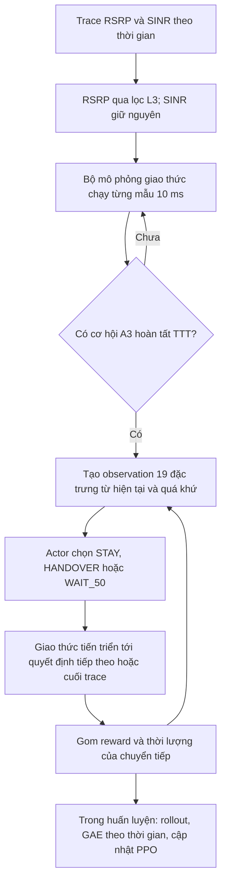

# Khung hiểu project và viết bài báo về handover UAV bằng SMDP-PPO

Ngày đánh giá: 13/09/2026. Cơ sở: bản `2026_conf_PPO_Handover_A2G (6).pdf`, mã và kết quả đang có trong workspace. Đây là hướng dẫn xây dựng lập luận và kế hoạch bằng chứng; không phải bản thảo đã hoàn thiện hoặc kết luận về khả năng được chấp nhận tại một hội nghị cụ thể.

Ưu tiên theo yêu cầu của tác giả: hiểu đúng project, xây dựng bài viết có thể bảo vệ về khoa học, sau đó mới rút xuống 6 trang, tính cả tài liệu tham khảo. Các ghi chú biên tập nằm trong PDF được xem là nội dung bản thảo để đánh giá.

## 1. Kết luận định hướng

Câu chuyện phù hợp nhất là **học chấp nhận hoặc từ chối cơ hội handover do A3 tạo ra, có tính đến thời gian vật lý giữa các quyết định, để điều chỉnh đánh đổi giữa estimated rate và độ ổn định kết nối của UAV**.

Project có môi trường giao thức, đặc trưng nhân quả, cách gom chuyển tiếp và PPO tương đối rõ ràng. Tuy nhiên, các kết quả hiện tại nên được coi là kết quả sơ bộ. Vấn đề đáng sửa nhất trước khi chốt thí nghiệm là bộ lấy mẫu huấn luyện: tập train khai báo 600 quỹ đạo, nhưng nhật ký chỉ ghi nhận 162 quỹ đạo thực sự được sử dụng.

Không nên đặt trọng tâm vào một khẳng định chung rằng “PPO tốt hơn 3GPP”. Kết quả đang cho thấy relative rate giảm, trong khi HOF, ping-pong và thời gian phục hồi RLF giảm. Giá trị của bài nằm ở chất lượng và cơ chế của đánh đổi đó, sau khi so sánh với các baseline đủ mạnh.

Tên bài đề xuất:

**Event-Triggered Handover Control for Cellular UAVs Using Duration-Aware PPO**

Tên nhấn mạnh kết quả, chỉ dùng khi bằng chứng đã vững:

**Balancing Rate and Mobility Reliability in Cellular UAV Networks with Event-Triggered PPO**

Không đưa “optimal”, “6G”, “uncertainty-aware”, “Hedge Algorithm” hoặc “guaranteed QoS” vào tên/keywords khi phương pháp và thí nghiệm chưa hỗ trợ.

## 2. Project thực sự làm gì?

### 2.1. Ranh giới của bài toán

UAV bay theo quỹ đạo có sẵn. Tại mỗi mẫu thời gian, dữ liệu cung cấp RSRP và SINR của các cell. Agent điều khiển việc chấp nhận một cơ hội handover; nó không điều khiển quỹ đạo UAV, công suất phát, anten, phân bổ tài nguyên, cell load hoặc bộ lập lịch.

Tập UAV đang được dùng có 21 cột đo vô tuyến. Thư mục nguồn mà tác giả xác nhận chứa 2.120 CSV, tương ứng 1.060 cặp RSRP/SINR. Thư mục đó hiện không chứa mã sinh kênh, quỹ đạo, cấu hình anten hoặc manifest mô phỏng. Vì vậy:

- Có thể xác minh số trace, số cell và các giá trị đầu vào.
- Chưa thể xác minh độc lập các mô tả LOS/NLOS, correlation distance, Doppler, Rician K, công suất phát và anten 8×4 chỉ từ các CSV này.
- Nguồn gốc hình học và kênh cần được gắn với mã sinh trace hoặc cấu hình có thể tái lập trước khi nộp bài.

Một cặp nguồn `30kmh_0` đã được kiểm tra: hai ma trận có kích thước 6.000×21, và các giá trị vô tuyến giống hệt bản đã chuyển đổi định dạng. Bộ chuyển đổi bổ sung schema và time column; nó không tự chứng minh rằng bộ sinh đã sử dụng bước thời gian vật lý 10 ms.

### 2.2. Luồng hoạt động

Trong triển khai suy luận, chỉ actor cần đưa ra hành động. Critic, rollout và optimizer thuộc giai đoạn huấn luyện. Training dùng tương tác mới với simulator dưới policy hiện tại, dù các trace vô tuyến đã được ghi sẵn; vì vậy “trace-driven on-policy RL” mô tả chính xác hơn việc gọi đây là offline RL trên một tập transition cố định.

### 2.3. Hai đồng hồ phải phân biệt

**Đồng hồ vô tuyến:** simulator tiến triển theo mẫu 10 ms, cập nhật radio measurement, timer, trạng thái kết nối và estimated rate.

**Đồng hồ quyết định:** actor chỉ được gọi khi A3 hoàn tất TTT. Khoảng cách giữa hai lần gọi có thể rất khác nhau và còn phụ thuộc hành động trước đó.

Ví dụ minh họa, không phải kết quả thực nghiệm: một quyết định STAY có thể dẫn đến quyết định mới sau 0,2 s; một quyết định khác có thể kéo dài 8 s. Dùng cùng hệ số chiết khấu cho cả hai khoảng sẽ làm số lượng sự kiện quyết định chi phối cách đánh giá tương lai. Project dùng `gamma_per_second ** duration_seconds` để gắn việc bootstrap với thời gian đã trôi qua.

Ở 200 test trace thuộc các tốc độ đã biết, PPO hiện có trung bình 30,11 quyết định trên mỗi trace 6.000 mẫu. Điều này cho thấy actor được gọi thưa hơn nhịp vô tuyến. Nó chưa chứng minh tốc độ chạy hoặc hiệu quả học tăng tương ứng; simulator vẫn xử lý các mẫu bên trong.

### 2.4. Quyền hạn của STAY, HANDOVER và WAIT_50

| Thành phần | Hành vi thực tế | Hệ quả đối với cách viết |
|---|---|---|
| Chọn ứng viên | Logic đo RSRP chọn ứng viên; tại cơ hội A3 hợp lệ, ứng viên là cell mạnh nhất phù hợp với logic hiện tại | Agent không giải bài toán chọn tùy ý một trong 21 cell |
| HANDOVER | Chốt target; bắt đầu preparation rồi execution | Quyết định có hậu quả kéo dài, không phải đổi cell tức thời |
| STAY | Từ chối và khóa lại sự kiện serving-target vừa xét đến khi A3 rời hoặc target đổi | Không diễn giải là “đợi 10 ms rồi cân nhắc lại” |
| WAIT_50 | Giữ event đang xét, tiến đúng 50 ms rồi hỏi lại nếu serving, target và A3 vẫn hợp lệ | Tạo lựa chọn trì hoãn ngắn có kiểm soát; không đồng nghĩa STAY và không chạy lại TTT |
| A3/TTT | Dùng các tham số cấu hình cố định | Không gọi phương pháp là học tối ưu trực tiếp TTT/Hys/CIO |
| Sau STAY | RLM và các timer vẫn tiếp tục chạy | Có nguy cơ ở lại serving cell quá lâu trước khi có cơ hội quyết định mới |

Cần đưa rõ cả cơ chế khóa sự kiện sau STAY và tái xét sau 50 ms của WAIT_50 vào mô tả phương pháp. Đây là một phần của không gian điều khiển và có thể ảnh hưởng đáng kể tới kết quả.

Mã đối chiếu: [engine.py](C:/Project/HandoverOptimDRL/src/ho_optim_drl/protocol/engine.py:125), [primitives.py](C:/Project/HandoverOptimDRL/src/ho_optim_drl/protocol/primitives.py:120).

### 2.5. Observation 19 chiều

| Nhóm | Số chiều | Câu hỏi mà agent được hỗ trợ trả lời |
|---|---:|---|
| Spectral efficiency của serving, target và chênh lệch | 3 | Target có ích về chất lượng truyền ngay lúc này không? |
| A3 margin: hiện tại, trung bình, nhỏ nhất, slope, độ lệch chuẩn | 5 | Lợi thế RSRP có ổn định trong cửa sổ đã quan sát không? |
| SINR slopes | 2 | Liên kết serving và target đang cải thiện hay suy giảm? |
| RLM: khoảng cách tới Qout/Qin, N310, trạng thái và tiến độ T310 | 5 | Có dấu hiệu mất liên kết đang tới gần không? |
| Lịch sử HO: residence, lần HO trước, previous cell, số HO gần đây | 4 | Quyết định có nguy cơ dẫn tới quay lại cell cũ hoặc chuyển quá dày không? |

Không có input vận tốc, vị trí hoặc độ cao một cách tường minh. Có thể nói thiết kế không yêu cầu đầu vào vận tốc; chưa thể kết luận nó đã suy ra vận tốc chính xác hoặc bất biến với mọi vận tốc.

Observation dùng quá khứ và hiện tại, nhưng **tính nhân quả không đồng nghĩa với tính Markov**. Hướng bay, vị trí và trạng thái kênh tiềm ẩn không được biểu diễn đầy đủ. Cách viết thận trọng: dùng một biểu diễn quan sát hữu hạn làm xấp xỉ trạng thái tại các thời điểm quyết định. Không tuyên bố đã chứng minh một SMDP quan sát đầy đủ trên vector 19 chiều.

### 2.6. Reward thực tế và ý nghĩa vật lý

Dùng `n` cho chỉ số mẫu vô tuyến và `k` cho chỉ số quyết định, để tránh dùng một ký hiệu cho hai loại thời gian.

Reward hiện tại:

\[
r_n=\Delta t\,\frac{\widehat D_n}{D_{\mathrm{ref}}}
-\beta_{\mathrm{RLF}}I_n^{\mathrm{RLF}}
-\beta_{\mathrm{PP}}I_n^{\mathrm{PP}},
\]

với `Delta t = 0.01 s`, `D_ref = 100 Mbps`, `beta_RLF = 5`, `beta_PP = 1`. Các indicator chỉ bật khi sự kiện bắt đầu/được ghi nhận; chúng không phạt lại cùng một sự kiện ở tất cả các mẫu.

Ở tốc độ 100 Mbps, một giây nhận dữ liệu cho +1 reward. Một RLF bị phạt 5, tương đương 5 giây truyền ở mức tham chiếu về mặt hàm utility; đây không phải tuyên bố rằng RLF thực tế gây gián đoạn 5 giây. Tương tự, PP bị phạt 1.

Draft dùng `alpha_rate = 0.01`. Con số khớp code khi bước mẫu là 10 ms, nhưng diễn giải nó đơn thuần là trọng số tùy chỉnh che mất ý nghĩa tích phân theo thời gian. Nên viết `Delta t` tường minh.

HOF không có một penalty độc lập. Trong mô hình này, HOF dẫn vào RLF recovery nên đã gây penalty RLF và mất rate. Cũng không có một penalty cố định cho mọi lần HO: chi phí execution đi vào reward qua mất dữ liệu, còn PP có penalty riêng.

Preparation vẫn cho phép nhận dữ liệu trên serving link trong code hiện tại. Chỉ khi execution bắt đầu thì kết nối bị ngắt. Một số mô tả trong `docs/reward.md` và docstring reward còn ghi preparation cũng bằng 0; cần ưu tiên hành vi thực tế và sửa tài liệu khi hoàn thiện project.

Mã đối chiếu: [reward.py](C:/Project/HandoverOptimDRL/src/ho_optim_drl/smdp/reward.py:104), [reference.py](C:/Project/HandoverOptimDRL/src/ho_optim_drl/protocol/reference.py), [engine.py](C:/Project/HandoverOptimDRL/src/ho_optim_drl/protocol/engine.py:303).

### 2.7. SMDP-PPO hiện tại và điểm cần thống nhất về toán

Mã gom reward không chiết khấu bên trong một macro-transition:

\[
R_k=\sum_{n\in\mathcal I_k}r_n,
\quad \tau_k=|\mathcal I_k|\Delta t,
\quad \Gamma_k=\gamma_{\mathrm{sec}}^{\tau_k}.
\]

GAE dùng thêm `Lambda_k = lambda_sec ** tau_k`. TD residual bootstrap bằng `Gamma_k`; chuỗi advantage sử dụng tích `Gamma_k Lambda_k`. Termination và truncation có mask riêng trong code.

Điểm phải quyết định trước khi viết phương trình objective cuối cùng:

1. **Mô tả đúng utility macro hiện tại:** `R_k` là tổng không chiết khấu trong khoảng, và chiết khấu áp dụng giữa các quyết định. Đây là một lựa chọn mô hình, cần phát biểu rõ.
2. **Nếu muốn tương đương chặt chẽ với tổng reward chiết khấu ở mọi mẫu vô tuyến:** reward trong mỗi macro cũng cần trọng số theo thời gian tương đối, chẳng hạn `R_k^disc = sum_i gamma_sec^(i Delta t) r_(n_k+i)` theo quy ước chỉ số đã thống nhất. Khi đó phải sửa implementation và huấn luyện/đánh giá lại.

Không gọi lựa chọn thứ nhất là phép gom “tương đương chính xác” với lựa chọn thứ hai. `gamma^tau` ở phần bootstrap chưa đủ để tạo ra sự tương đương đó.

Một phân biệt nữa: code chọn checkpoint bằng **tổng reward không chiết khấu** trên phần trace từ quyết định đầu, trong khi target học có chiết khấu theo thời gian. Đây có thể là tiêu chí chọn mô hình có chủ đích, nhưng cần được công bố thay vì nói hai đại lượng hoàn toàn giống nhau.

Nguồn code: [transition.py](C:/Project/HandoverOptimDRL/src/ho_optim_drl/smdp/transition.py:176), [rollout.py](C:/Project/HandoverOptimDRL/src/ho_optim_drl/agents/ppo/rollout.py:119), [trainer.py](C:/Project/HandoverOptimDRL/src/ho_optim_drl/agents/ppo/trainer.py:338).

## 3. Những bằng chứng đã xác minh

### 3.1. Định danh thí nghiệm phù hợp với draft

- Dữ liệu nguồn: `data/UAV_data_100m_grid100m`.
- Dữ liệu runtime: `data/uav_100m_grid100m_dev_processed`.
- Run: `results/models/uav_100m_grid100m_ppo_30_90`.
- Benchmark tương ứng các hình: `results/benchmark/uav_100m_grid100m_all_speeds_percent`.
- PPO seed và split seed: 17.
- Training budget: 300.000 macro-transitions, 586 updates.
- Checkpoint được chọn: tại 190.464 macro-transitions, update 372, theo validation mean return.

Không trộn kết quả từ thư mục terrestrial, 300 m, dataset 60-route/speed hoặc các lần locked-test khác vào cùng một bảng mà thiếu định danh mô hình và dataset.

### 3.2. Tập khai báo và tập thực sự được lấy mẫu

| Vận tốc (km/h) | Tổng nguồn | Train khai báo | Validation | Test cùng miền | Train thực sự đã dùng trong run |
|---|---:|---:|---:|---:|---:|
| 30 | 420 | 252 | 84 | 84 | 67 |
| 50 | 255 | 153 | 51 | 51 | 49 |
| 70 | 180 | 108 | 36 | 36 | 30 |
| 90 | 145 | 87 | 29 | 29 | 16 |
| Tổng 30–90 | 1.000 | 600 | 200 | 200 | **162** |
| 120 | 30 | 0 | 0 | 0 | 0 |
| 150 | 30 | 0 | 0 | 0 | 0 |

Hai hàng cuối là 60 trace đánh giá vận tốc chưa thấy, tách khỏi test cùng miền.

Đã đối chiếu SHA-256 của 2.000 file thuộc manifest train/validation/test: tất cả khớp manifest. Có 1.000 cặp nội dung phân biệt. Các trace benchmark ở tốc độ 30–90 khớp đúng test manifest; không trùng ID với train hoặc validation. Điều này hỗ trợ tính toàn vẹn của split hiện có, nhưng không chứng minh độc lập về quỹ đạo hình học, seed sinh kênh hoặc địa hình giữa các trace.

**Vấn đề lấy mẫu của run lịch sử:** cả checkpoint được chọn và toàn run chỉ ghi nhận 162 train trace. Có 438 trace trong train split không có macro-transition nào được ghi nhận. Phiên bản code đã chạy từng để `evaluate()` xóa trạng thái collector; lần `collect_rollout()` tiếp theo gọi `env.reset(seed=17)` lại. Nhật ký cho thấy sau các lần validation, lấy mẫu bắt đầu lại ở `30kmh_210`.

Nguồn: [trainer.py, chỗ seed collector](C:/Project/HandoverOptimDRL/src/ho_optim_drl/agents/ppo/trainer.py:134), [trainer.py, logic bảo vệ collector hiện tại](C:/Project/HandoverOptimDRL/src/ho_optim_drl/agents/ppo/trainer.py:418), [training report](C:/Project/HandoverOptimDRL/results/models/uav_100m_grid100m_ppo_30_90/training_report.json).

Trạng thái hiện tại: source đã sửa để validation environment riêng không xóa collector/RNG của train và đã có regression test; evaluate trực tiếp trên train environment vẫn xóa cache để tránh observation cũ. Chưa huấn luyện lại, nên số liệu 162/600 và checkpoint trên vẫn là artifact lịch sử có lỗi.

Không viết “trained on 1,000 trajectories”: 1.000 là tổng development pool. Kể cả câu “trained on 600 trajectories” cũng cần phân biệt train split với những trace thực sự đóng góp dữ liệu tối ưu trong run hiện tại.

### 3.3. Kết quả sơ bộ đã tính lại từ per-trajectory CSV

| Tập | Policy | Relative rate (%) | HOF (%) | RLF recovery time (%) | PP (%) |
|---|---|---:|---:|---:|---:|
| Test cùng miền, 200 trace | A3 Always-HO | 91,13 | 10,65 | 1,294 | 38,14 |
| Test cùng miền, 200 trace | PPO | 85,12 | 7,59 | 0,987 | 12,51 |
| Vận tốc chưa thấy, 60 trace | A3 Always-HO | 85,46 | 15,62 | 2,830 | 36,54 |
| Vận tốc chưa thấy, 60 trace | PPO | 79,25 | 10,69 | 1,547 | 15,55 |
| Gộp 260 trace, tham khảo | A3 Always-HO | 89,82 | 12,18 | 1,649 | 37,67 |
| Gộp 260 trace, tham khảo | PPO | 83,76 | 8,64 | 1,116 | 13,52 |

Relative rate là trung bình các tỷ lệ của từng trajectory. HOF và PP được tính từ tổng tử số/tổng mẫu số; RLF time từ tổng thời gian. Không thay bằng trung bình tùy tiện các tỷ lệ HOF/PP từng trace.

Nguồn: [per_trajectory.csv](C:/Project/HandoverOptimDRL/results/benchmark/uav_100m_grid100m_all_speeds_percent/per_trajectory.csv), [by_speed.csv](C:/Project/HandoverOptimDRL/results/benchmark/uav_100m_grid100m_all_speeds_percent/by_speed.csv).

Cách đọc test cùng miền: PPO mất khoảng **6,01 điểm phần trăm** relative rate, đổi lại HOF giảm khoảng 28,7% tương đối, PP giảm khoảng 67,2% tương đối và RLF recovery time giảm khoảng 23,7% tương đối. Các số này mô tả checkpoint hiện tại; chưa có độ bất định do nhiều training seed.

HOF giảm không tự động chứng minh kết nối tốt hơn: agent có thể đơn giản làm ít HO. Trong 200 trace, số HO attempts giảm từ 7.316 xuống 3.437; HOF từ 779 xuống 261; tổng RLF từ 779 xuống 593. Theo quan hệ HOF dẫn vào RLF trong mô hình, chênh lệch số đếm cho thấy cần phân tích thêm RLF không do HOF khi agent ở lại cell cũ. Đây là hướng kiểm tra cơ chế, không nên suy diễn nguyên nhân từ một đường trung bình.

### 3.4. Mức độ xác minh

- Đã đọc toàn bộ 9 trang draft và xem ảnh render của từng trang.
- Đã kiểm tra các lớp dữ liệu, giao thức, observation, reward, macro-transition, môi trường, PPO, split, checkpoint và benchmark liên quan trực tiếp đến lập luận bài báo.
- Đã chạy bộ kiểm thử sẵn có: **78 tests qua**.
- Đã đối chiếu số liệu, manifest và coverage huấn luyện như trên.
- Chưa chạy lại toàn bộ benchmark hoặc retrain; các giá trị kết quả là từ artifact đã lưu.
- Chưa có mã sinh trace để xác minh đầy đủ System Model.

## 4. Các điểm cần sửa trước khi chốt nội dung

| Ưu tiên | Điểm cần xử lý | Vì sao ảnh hưởng khoa học | Hành động cụ thể |
|---|---|---|---|
| Bắt buộc | Run cũ chỉ dùng 162/600 train trace | Mô tả training data và độ phủ dữ liệu chưa phản ánh run | Source đã sửa collector và có test; ghi coverage rồi chạy lại |
| Bắt buộc | Eq. (11) đặt serving cell bằng argmax RSRP tại mẫu trước | Serving cell là trạng thái giao thức, không tự đổi theo argmax | Viết quy tắc cập nhật qua HO thành công, disconnect và reconnection |
| Bắt buộc | Artifact dataset cũ không có metadata radio | Không chứng minh được cấu hình sinh trace lịch sử dù source hiện đã thống nhất 2,1 GHz/10 MHz/10 ms | Regenerate/prepare có manifest và lưu cả cấu hình vào checkpoint |
| Bắt buộc | Ý nghĩa tổng reward và discount chưa phát biểu đầy đủ | Có thể viết objective không đúng code | Chọn rõ macro utility hiện tại hoặc discounted primitive objective và đồng bộ implementation |
| Bắt buộc | Cách gọi 3GPP và RLM | Có nhiều proxy, không phải NR stack đầy đủ | Gọi baseline A3-based/3GPP-inspired; công bố Qin/Qout là SINR proxy |
| Bắt buộc | Chưa phân tích RLF time dù đã định nghĩa | HOF/PP giảm có thể che chi phí STAY quá lâu | Thêm RLF time và số sự kiện trên đơn vị thời gian |
| Bắt buộc | Một seed, baseline còn yếu | Chưa tách khả năng học khỏi may mắn và cấu hình A3 chưa phù hợp | Thêm seeds, tuned A3, heuristic gate và các ablation trọng tâm |
| Cần rõ | Vector 19 chiều gọi là state Markov | Chưa có chứng minh đầy đủ thông tin trạng thái | Gọi observation/approximate state và nêu giới hạn quan sát |
| Cần rõ | Điều kiện A3 trong draft mô tả nhiều neighbor và ngưỡng đơn | Code xét ứng viên hiện tại và giữ trạng thái trong deadband | Mô tả entering, leaving, cách reset TTT khi target đổi theo code |
| Cần rõ | “AMC ceiling, if enforced” | Câu văn chưa xác định mô hình thực tế | Rate hiện dùng SINR raw; clipping đặc trưng không phải mô hình AMC |
| Cần rõ | Source trace không kèm generator | Không kiểm chứng được các giả thiết hình học/kênh đã ghi | Bổ sung generator, cấu hình và seed hoặc thu hẹp mô tả tới trace-driven setting |
| Biên tập | Abstract/Introduction trống, thiếu Conclusion, còn nội dung template | Chưa có luận đề và thông điệp kết thúc | Viết sau khi chốt câu hỏi, đóng góp, phương pháp và bằng chứng |
| Biên tập | 80–120 km/s, Hedge, Uncertainty-Aware, 6G, `??`, `[ref]` | Sai đơn vị hoặc không khớp phạm vi nghiên cứu | Sửa km/h, keywords, nhãn và dẫn nguồn |

Về bandwidth: source hiện tại cho generator và runtime dùng chung mặc định 2,1 GHz/10 MHz/10 ms. Thay đổi này không chứng minh trace cũ được sinh ở 2,1 GHz vì `fc` của loader không sinh lại kênh. `bw` được dùng trực tiếp trong estimated rate và reward; nếu bandwidth thật của trace lịch sử khác 10 MHz thì trọng số rate so với penalty khi học cũng khác. Không thể khắc phục toàn bộ bằng cách đổi metadata hoặc nhân các trục Mbps sau huấn luyện.

Checkpoint hiện lưu PPO config và metadata split, chưa lưu trọn bộ protocol/reward/observation config. Đây là điểm cần bổ sung để tránh các kết quả cũ bị diễn giải bằng cấu hình hiện tại đã thay đổi.

Về serving cell, dùng một quy tắc theo trạng thái giao thức: giữ cell đang phục vụ khi còn kết nối; cập nhật sang target khi HO thành công; đặt disconnected khi execution/recovery yêu cầu; chọn cell phù hợp khi tái kết nối. Trong code hiện tại, initial/recovery cell search chọn cell có SINR lớn nhất vượt Qin proxy.

## 5. Tính mới có thể bảo vệ đến đâu?

### 5.1. Những nền tảng phải thừa nhận

PPO và GAE là phương pháp đã có; temporal abstraction/SMDP cũng là nền tảng lâu đời. PPO cho adaptive handover đã xuất hiện ở công trình gốc mà repository kế thừa. Vì vậy “dùng PPO”, “dùng DRL” hoặc “tối ưu handover” riêng lẻ không đủ làm đóng góp mới. Xem [PPO](https://arxiv.org/abs/1707.06347), [GAE](https://arxiv.org/abs/1506.02438), [SMDP/options](https://www.sciencedirect.com/science/article/pii/S0004370299000521) và [Voigt et al.](https://arxiv.org/abs/2503.21601).

Phần có thể phát triển thành đóng góp của bài là cách đặt bài toán và kiểm chứng nó trong môi trường UAV cụ thể:

1. **Tích hợp quyết định tại cơ hội A3:** cơ chế categorical admission/defer với target latching, event suppression sau STAY và tái xét sau WAIT_50, trên một engine giao thức chung cho các policy.
2. **Thiết kế học theo thời gian và trạng thái giao thức:** observation nhân quả kết hợp chất lượng liên kết, RLM và lịch sử HO; return/advantage tính đến thời lượng giữa các quyết định.
3. **Bằng chứng về đánh đổi và vận tốc ngoài miền học:** đánh giá đồng thời rate, HOF, RLF time, PP trên trace ghép cặp, kèm ablation và đánh giá vận tốc chưa dùng trong train/validation.

Đây là các trục đóng góp đề xuất. Muốn khẳng định sự mới so với toàn bộ literature cần khảo sát có hệ thống các nghiên cứu handover UAV theo sự kiện, bán Markov và policy dùng trạng thái giao thức. Lần đối chiếu này không đủ để đưa ra claim “first”.

### 5.2. Ba câu hỏi nghiên cứu nên dẫn toàn bài

**RQ1 — Hiệu quả thực dụng:** policy có đạt một đánh đổi rate–reliability tốt hơn các baseline được tinh chỉnh hợp lý trong cùng môi trường không?

**RQ2 — Cơ chế:** duration-aware learning và các nhóm đặc trưng RLM/HO-history đóng góp gì? Khi bỏ từng thành phần, điều gì thay đổi?

**RQ3 — Ngoại suy vận tốc:** policy cố định còn giữ được đánh đổi đó ở 120 và 150 km/h, ngoài dải vận tốc đã dùng trong training và checkpoint selection, không?

Nếu RQ2 cho thấy duration-aware PPO không hơn biến thể discount cố định, vẫn phải báo cáo trung thực. Khi đó trọng tâm nên chuyển sang event-triggered control và phân tích trade-off; không giữ tuyên bố duration-aware là nguồn cải thiện chính.

### 5.3. Một điểm về động cơ RSRP/SINR cần viết chính xác

Trong mô hình đồng kênh đơn giản mà mọi cell còn lại đều gây nhiễu với cùng nền nhiễu N, `SINR_j = S_j / (sum_i S_i - S_j + N)` tăng đơn điệu theo công suất nhận `S_j` tại cùng thời điểm. Vì vậy không nên khẳng định rằng cell có RSRP raw mạnh nhất tất yếu khác cell có SINR tốt nhất trong chính mô hình đó.

Lợi ích phù hợp hơn của SINR là thể hiện chất lượng tuyệt đối, khoảng cách tới ngưỡng phục hồi/lỗi và diễn biến theo thời gian; L3 RSRP còn tạo độ trễ so với SINR raw. Một cell mạnh nhất vẫn có thể có SINR tuyệt đối thấp khi nhiễu tổng lớn. Cũng cần thống nhất công suất reference signal với công suất dùng tính SINR và noise bandwidth trước khi dùng Eq. (6)–(9) làm mô tả generator.

## 6. Khung bài viết đầy đủ để điền nội dung

Viết bản làm việc đầy đủ theo các mục dưới đây trước. Mỗi đoạn phải trả lời một câu hỏi cụ thể; mỗi claim về hiệu quả phải có hình, bảng hoặc phép kiểm tra đứng sau.

### Title, Abstract và Keywords — viết cuối

**Abstract gồm khoảng 5 câu, mỗi câu một nhiệm vụ:**

1. Vấn đề: các cơ hội handover dựa trên đo vô tuyến có thể dẫn đến đánh đổi chất lượng truyền và độ ổn định trong kịch bản UAV đang xét.
2. Khoảng trống: cần đánh giá hậu quả theo thời gian của việc chấp nhận/từ chối các cơ hội A3, cùng trạng thái RLM và lịch sử HO.
3. Phương pháp: policy nhị phân theo sự kiện, observation 19 chiều, PPO dùng thời lượng macro-transition.
4. Bằng chứng: nêu đúng dataset/split/baseline và hai hoặc ba kết quả định lượng chính sau khi rerun. Nêu cả chi phí rate nếu nó tồn tại.
5. Kết luận có điều kiện: tác dụng trong setting đã thử và kết quả trên vận tốc chưa thấy; tránh bảo đảm tổng quát.

Keywords gợi ý: Cellular UAV; Handover; Semi-Markov Decision Process; Proximal Policy Optimization; Mobility Reliability.

### I. Introduction

**Câu hỏi phải trả lời:** tại sao vấn đề này đáng giải, công trình trước còn thiếu gì và bài này kiểm chứng điều gì?

| Đoạn | Nội dung cần viết | Bằng chứng/nguồn phải đi kèm |
|---|---|---|
| 1 | Kịch bản cellular-connected UAV và yêu cầu duy trì kết nối | Nguồn A2G/UAV phù hợp, không kể rộng lịch sử 5G/6G |
| 2 | Quyết định HO có chi phí gián đoạn và rủi ro; ở lại cũng có rủi ro | Cơ chế được mô hình hóa, tránh nói mọi HO đều vô ích |
| 3 | Related work theo nhóm: A3 tuning; learned HO; event/temporal modeling | Bảng so sánh literature trong ghi chú làm việc trước khi viết đoạn cô đọng |
| 4 | Khoảng trống cụ thể và câu hỏi chính | Phân biệt novelty của thiết kế với chỉ thay dataset |
| 5 | Ba đóng góp, mỗi đóng góp gắn thí nghiệm kiểm chứng | RQ1–RQ3; không dùng “optimal” nếu chỉ có empirical result |

Một câu xương sống có thể phát triển: “We study whether learning to accept or reject completed A3 opportunities can improve the rate–reliability trade-off for cellular UAVs when decision outcomes unfold over unequal physical durations.”

Không cần một mục Background dài giải thích từng message Uu/Xn/NG nếu các message đó không được mô phỏng và không tác động riêng lên policy.

### II. System Model and Problem Statement

**II-A. Trace-driven A2G setting:** nêu một UAV, cell deployment, mobility, các radio streams và giả thiết ngoại sinh của trace. Phân biệt tham số được xác minh từ CSV và tham số cần generator xác nhận. Giữ công thức kênh chỉ ở mức cần tái lập hoặc hiểu vấn đề; các thành phần kinh điển có thể dẫn nguồn.

**II-B. Protocol dynamics and decision opportunities:** trình bày serving state, candidate, lọc L3, entering/leaving A3, TTT, preparation, execution, HOF và RLF recovery. Dùng một sơ đồ thời gian cho thấy nơi actor được gọi và thời gian mất dữ liệu. Nêu rõ policy A3 reference chấp nhận mọi cơ hội trong simulator.

**II-C. Utility and scope:** định nghĩa estimated delivered rate, penalty event và mục tiêu trade-off. Nêu các yếu tố không được mô hình hóa có ảnh hưởng thực chất: scheduler/load, BLER thực, RRC signalling chi tiết. Chưa có cơ sở viết rằng phương pháp tối ưu mọi QoS hoặc user throughput đo thực.

**Điều kiện hoàn thành mục II:** người đọc hiểu input đến từ đâu, serving cell thay đổi lúc nào, lỗi được đếm thế nào và policy được phép can thiệp ở đâu.

### III. Event-Triggered SMDP-PPO Handover Control

**III-A. Decision process:** định nghĩa primitive index `n`, decision index `k`, thời điểm `t_k`, tập mẫu `I_k`, thời lượng `tau_k`. Nêu transition `(o_k, a_k, R_k, tau_k, o_(k+1))`, terminal và phần prefix trước quyết định đầu.

**III-B. Observation and actions:** dùng một bảng 5 nhóm/19 chiều thay cho 5 tiểu mục gần lặp nhau. Giải thích tại sao nhóm đó có thể hữu ích và chỉ định ablation tương ứng. Ghi normalization/window quan trọng. Mô tả chính xác tác dụng kéo dài của STAY, target latching của HO và điều kiện tái xét/hủy của WAIT_50.

**III-C. Reward and objective:** một phương trình reward với `Delta t`; một phương trình macro utility/objective đã thống nhất. Giải thích đơn vị, event counting, HOF dẫn vào RLF và vì sao không có penalty HOF độc lập. Nêu trọng số là lựa chọn utility cần sensitivity analysis.

**III-D. Duration-aware learning:** trình bày `Gamma_k`, `Lambda_k`, TD residual, GAE và masked bootstrapping. PPO clipped loss chỉ cần công thức chính cùng citation; không trình bày mọi loss chuẩn như một đóng góp mới. Nêu shared encoder 19→64→64, policy head 3 logits và value head 1 scalar.

**III-E. Training and inference:** phân biệt action sampling khi train với argmax khi test; rollout theo macro-transitions; chọn checkpoint trên validation; suy luận dùng actor. Algorithm khoảng 12–18 dòng, tập trung phần khác biệt về event và duration.

**Điều kiện hoàn thành mục III:** một người khác có thể dựng lại interface environment–agent và return/advantage mà không phải đoán từ hình vẽ.

### IV. Experimental Setup

**IV-A. Data and split:** bảng số lượng theo tốc độ; split theo toàn trajectory; seed sinh dữ liệu, split seed và training seed là ba loại khác nhau; hash manifest; coverage sampling thực tế. Tách 200 test cùng miền khỏi 60 test vận tốc chưa thấy.

**IV-B. Baselines and ablations:** định nghĩa từng policy và thông tin nó được sử dụng. Baseline dùng cùng trace, protocol engine, timer, start state và định nghĩa metric. Tuning chỉ dùng validation, theo cùng tiêu chí lựa chọn được công bố.

**IV-C. Training and selection:** ngân sách macro-transitions, kiến trúc, optimizer, các trọng số reward, gamma/lambda, validation interval, checkpoint selection metric, số seeds. Ghi rõ total budget và checkpoint được chọn có thể ở thời điểm sớm hơn.

**IV-D. Metrics and statistics:** RR, HOF, PP, RLF recovery time, cùng event counts/time khi cần. Nêu cách gộp, N/A với mẫu số 0, đơn vị thống kê là trajectory và training seed. Không dùng 6.000 mẫu liên tiếp như 6.000 quan sát độc lập.

### V. Results and Discussion

**V-A. Main trade-off, trả lời RQ1:** bắt đầu bằng bảng/hình so sánh đầy đủ bốn metric; nói policy thắng ở đâu, thua ở đâu, chi phí bao nhiêu. Đối chiếu tuned A3 và heuristic gate. Reward tăng không tự nó chứng minh giá trị thực dụng, vì reward do tác giả thiết kế.

**V-B. Why does it work, trả lời RQ2:** ablation duration-aware; ablation RLM/HO-history; sensitivity của PP/RLF penalties. Dùng một case study đã chọn theo tiêu chí minh bạch để minh họa A3 phát sinh, policy hành động, target quality, HO outcome và rate mất đi. Case study giải thích cơ chế, không thay thế thống kê.

**V-C. Unseen-speed evaluation, trả lời RQ3:** giữ nguyên policy, không fine-tune, hiển thị riêng 120/150 km/h. Kết luận ở mức ngoại suy vận tốc trên cùng setting; không suy ra khả năng chuyển sang topology, độ cao hoặc môi trường đô thị khác.

**V-D. Limitations:** trade-off rate; một UAV và trace ngoại sinh; RLM/HOF proxies; finite observation; điểm không tốt hoặc nơi baseline mạnh hơn. Đặt limitation cạnh claim liên quan thay vì giấu toàn bộ ở cuối.

Mỗi đoạn kết quả dùng nhịp: **phát hiện định lượng → bằng chứng → giải thích có điều kiện → giới hạn**. Tránh chỉ đọc lại mọi điểm trên đường cong.

### VI. Conclusion

Một đoạn ngắn: vấn đề đã giải trong phạm vi nào; thiết kế cốt lõi; kết quả đánh đổi định lượng; giới hạn và một hướng tiếp theo trực tiếp. Không đưa vào kết luận claim mới về real-world deployment, hội tụ tối ưu hoặc 6G.

## 7. Ma trận thí nghiệm và bằng chứng cần bổ sung

| Thí nghiệm | Câu hỏi được giải quyết | Thiết kế tối thiểu đề xuất | Nếu thiếu thì không được khẳng định |
|---|---|---|---|
| A3 reference và tuned A3 | Lợi ích có vượt cấu hình A3 hợp lý không? | Tune Hys/offset/TTT trên validation; cùng simulator và metrics | PPO vượt các phương pháp truyền thống nói chung |
| Simple SINR gate | Có cần học phức tạp hơn quy tắc đơn giản không? | Tại cùng A3 decision, chấp nhận theo SINR target/gap; chọn threshold bằng validation | DRL cần thiết chỉ vì hơn Always-HO |
| Event-PPO với discount cố định | `gamma^tau`, `lambda^tau` có giúp không? | Cùng decision process, observation, reward, budget, seeds; công bố cách chọn fixed gamma/lambda | Duration-aware là nguyên nhân cải thiện |
| Bỏ RLM và/hoặc HO-history | Thông tin giao thức có giá trị không? | Huấn luyện lại biến thể; không chỉ zero feature khi test | 19 đặc trưng là thiết kế tối ưu |
| Reward sensitivity | Trade-off có phụ thuộc mạnh trọng số không? | Chọn vài mức penalty định trước trên validation; vẽ rate–reliability | Các trọng số hiện tại có tính phổ quát |
| Nhiều training seeds | Kết quả có ổn định với ngẫu nhiên huấn luyện không? | Khuyến nghị ít nhất 5 seed nếu ngân sách cho phép; báo đầy đủ, không chọn seed đẹp | Ý nghĩa thống kê/độ ổn định từ một đường cong |
| 120/150 km/h chưa thấy | Khả năng ngoại suy vận tốc | Loại khỏi train và checkpoint selection; không fine-tune | Zero-shot vượt ngoài đúng chiều dịch chuyển đã thử |

Với fixed-discount ablation, không chọn một gamma cố định bất lợi tùy tiện. Có thể lấy mốc từ thời lượng điển hình của train để giữ horizon gần tương đương, rồi công bố sensitivity hoặc quy tắc tuning. Nếu so sánh với PPO quyết định mỗi 10 ms, phải tách tác động của tần suất quyết định khỏi tác động của discount và action constraints; đó là một thí nghiệm bổ sung, không nên đưa vào gấp nếu chưa làm công bằng.

Confidence interval: ghép cặp các policy trên cùng trajectory, bootstrap ở cấp trajectory; với nhiều seed, tách biến thiên do training seed và do test trajectory. Khi bootstrap HOF/PP, mỗi mẫu bootstrap phải tính lại tỷ lệ từ tổng counts, không lấy mean của các tỷ lệ thiếu ổn định. Công bố cả số lần attempts/successes.

Số route theo tốc độ không cân bằng. Báo cáo từng tốc độ là chính; nếu gộp, nói rõ đang dùng trọng số theo số trajectory. Có thể bổ sung trung bình cân bằng giữa các tốc độ để tránh tổng thể bị nhóm 30 km/h chi phối.

Nếu tác giả dùng kết quả 120/150 để liên tục sửa thiết kế, chúng trở thành dữ liệu đã được nhìn trong quá trình phát triển. Cần ghi nhận điều đó và dành một đợt quỹ đạo mới chưa xem cho xác nhận cuối cùng; không chỉ đổi tên thư mục thành “locked test”.

## 8. Bộ hình và bảng nên chuẩn bị

### Hình 1: giao thức và thời điểm ra quyết định

Một timeline thể hiện mẫu radio, A3/TTT, actor, ba nhánh STAY suppression, WAIT_50 rồi tái xét, hoặc HO prep/exec, lần quyết định tiếp theo và `tau_k`. Đánh dấu phần nào truyền dữ liệu, phần nào gián đoạn. Đây là hình quan trọng nhất để người đọc hiểu lý do dùng SMDP.

### Hình 2: kết quả bốn metric theo tốc độ

Bốn panel: relative rate, HOF, RLF recovery time, PP; đánh dấu vận tốc chưa thấy và hiển thị uncertainty phù hợp. Không để RLF biến mất khỏi kết quả khi nó là thành phần reward chính. Giữ cùng nhãn policy, legend, ký hiệu và đơn vị.

### Hình 3: cơ chế hoặc sensitivity

Ưu tiên đồ thị trade-off/ablation phục vụ đóng góp. Nếu chọn trace case study, nêu tiêu chí chọn, tránh chỉ lấy một trace tốt nhất. Hình topology có thể nhỏ hoặc đưa sang supplement nếu không phải đóng góp chính.

### Bảng I: cấu hình và dữ liệu

Gộp tham số radio đã xác minh, protocol timers, reward/PPO quan trọng và số trace/split. Không trộn `bandwidth khi sinh SINR` với `bandwidth quy đổi rate` nếu chúng khác nhau.

### Bảng II: baseline và ablation

Các metric chính và CI, kèm counts khi đủ chỗ. Luôn phân biệt điểm phần trăm và giảm tương đối. Một thay đổi 10%→7% là giảm 3 điểm phần trăm hay 30% tương đối.

## 9. Chuyển từ draft hiện tại sang khung đề xuất

| Phần hiện tại | Cách xử lý |
|---|---|
| Introduction đang trống | Viết sau khi có claim–evidence map; bổ sung related work trực tiếp |
| Background về toàn bộ signalling | Rút thành phần giao thức cần cho bài toán, chuyển sang System Model |
| Terrestrial vs A2G | Giữ những khác biệt có tác động đến thí nghiệm; bỏ khẳng định tổng quát chưa có nguồn hoặc dữ liệu đối chứng |
| Geometry/channel nhiều phương trình | Chỉ giữ phần cần tái lập và đã đối chiếu generator; không biến thành phần giới thiệu kiến thức kênh |
| State 19 chiều trình bày dài | Gom 5 nhóm thành một bảng và giải thích vai trò/ablation |
| Reward và PPO | Viết lại reward có đơn vị; làm rõ objective; tập trung vào duration và masking |
| Training prose và Algorithm 31 dòng | Bỏ lặp, thuật toán chỉ giữ bước đặc thù |
| Three separate result figures | Chuyển thành bốn panel có RLF time; dùng chỗ còn lại cho ablation |
| References 5 mục | Bổ sung PPO, GAE, SMDP, chuẩn trực tiếp và related work gần nhất; sửa metadata bài gốc |
| Acknowledgment template | Xóa template; chỉ thêm nội dung thực khi có |

Draft hiện có 43 phương trình được đánh số nhưng chưa có Introduction hoàn chỉnh. Vấn đề không phải thiếu công thức; vấn đề là thiếu chuỗi lý do từ research gap đến lựa chọn thiết kế rồi đến bằng chứng. Bản tiếp theo nên chốt chuỗi đó trước khi tối ưu cách dàn trang.

## 10. Phương án nén xuống 6 trang sau khi nội dung đã vững

Đây là ngân sách tham khảo, đã tính diện tích hình/bảng nằm trong từng mục:

| Phần | Số trang xấp xỉ |
|---|---:|
| Title, authors, abstract, keywords | 0,45 |
| I. Introduction và related work | 0,75 |
| II. System model và problem statement | 0,85 |
| III. Proposed method | 1,35 |
| IV. Experimental setup | 0,55 |
| V. Results and discussion | 1,25 |
| VI. Conclusion | 0,15 |
| References | 0,65 |
| **Tổng** | **6,00** |

Nếu phải cắt, ưu tiên: signalling không mô phỏng; phương trình hình học/kênh kinh điển đã có nguồn; diễn giải PPO chuẩn; lặp giữa hình và văn bản. Giữ các giả thiết có ảnh hưởng kết quả, thiết kế thí nghiệm, uncertainty và kết quả bất lợi. Không thu nhỏ chữ bất thường để giữ mọi chi tiết.

## 11. Thứ tự công việc cụ thể

1. Chốt một trang “research contract”: can thiệp vào đâu, mục tiêu nào, baseline nào, câu hỏi nào và metric nào xác nhận.
2. Sửa/kiểm chứng sampling qua validation; quyết định reward-discount semantics; thống nhất cấu hình radio/runtime và khả năng tái lập.
3. Đối chiếu generator với System Model; nếu chưa có generator, ghi rõ phạm vi trace-driven và nguồn dữ liệu chưa đủ để xác minh thành phần nào.
4. Khóa protocol, reward, preprocessing, split, baseline tuning và checkpoint selection trước thí nghiệm chính; lưu cấu hình đầy đủ.
5. Chạy multi-seed, tuned baseline và ablation trọng tâm; xuất dữ liệu gốc theo trajectory và nguyên nhân sự kiện.
6. Dựng bảng/hình chính, viết câu kết luận cho từng hình và đánh dấu các claim chưa đủ bằng chứng.
7. Viết System Model → Method → Experimental Setup → Results. Trong giai đoạn này, có thể viết đầy đủ hơn 6 trang.
8. Viết Introduction, contributions, Abstract và Conclusion dựa trên kết quả thực tế.
9. Rà soát từng claim, nguồn tham khảo, đơn vị, notation, dataset/model identity; sau đó mới nén trang.

Tiêu chí dừng vòng draft: mỗi contribution trỏ tới ít nhất một kiểm chứng; mọi phương trình khớp implementation; mỗi số kết quả truy được về dataset/config/checkpoint; mọi phạm vi tổng quát hóa được nói đúng.

## 12. Nguồn nền tảng cần đặt đúng vai trò

- Quy tắc A3 và RRC/RLM: [ETSI TS 138 331 V15.3.0 / 3GPP TS 38.331](https://www.etsi.org/deliver/etsi_ts/138300_138399/138331/15.03.00_60/ts_138331v150300p.pdf). Phiên bản này là nguồn mà baseline audit hiện tại viện dẫn; không tự động gán mô hình là toàn bộ NR stack phù hợp chuẩn.
- Nguồn protocol implementation và adaptive HO bằng PPO kế thừa: [Voigt et al., bài báo](https://arxiv.org/abs/2503.21601). Metadata xuất bản chính thức là SCC 2025, DOI `10.1109/IEEECONF62907.2025.10949111`, được xác nhận tại [KIT](https://publikationen.bibliothek.kit.edu/1000182198). Không chỉ dẫn GitHub dưới nhãn technical report khi muốn dẫn bài hội nghị.
- Thuật toán nền: [Schulman et al., PPO](https://arxiv.org/abs/1707.06347), [Schulman et al., GAE](https://arxiv.org/abs/1506.02438).
- Temporal abstraction: [Sutton, Precup và Singh, 1999](https://www.sciencedirect.com/science/article/pii/S0004370299000521).

Các nguồn trên xác lập nền tảng và ranh giới kế thừa; chúng không thay thế việc rà literature gần nhất để xác lập novelty cho UAV handover. Với công thức kênh/anten, cần đọc đúng tài liệu gốc và phiên bản được generator sử dụng trước khi hoàn thiện bibliography.
